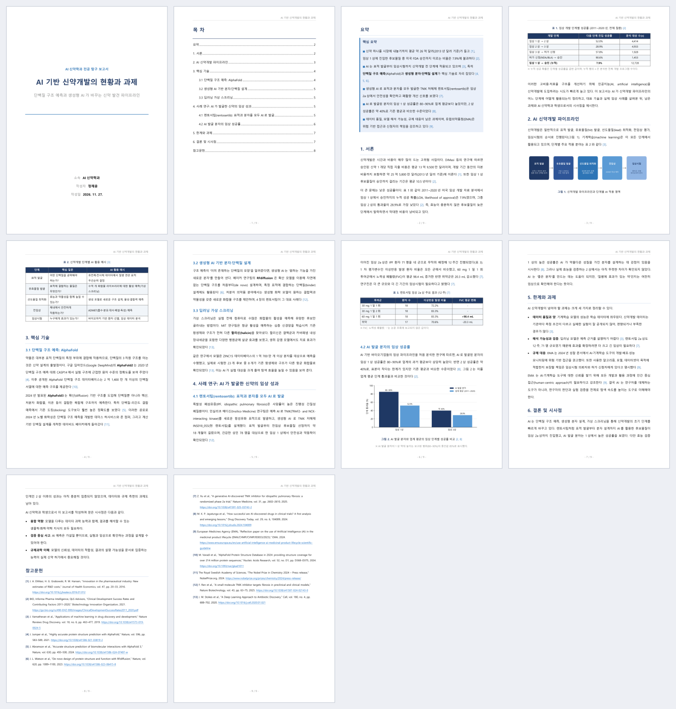

# 📝 DOCX 보고서 작성 스킬 (docx-report-writer)

Claude Code에서 쓸 수 있는 **보고서 작성 스킬**입니다.
정해 둔 작성·디자인 규칙(R1~R16)에 따라 한국어 보고서를 **Word(.docx)** 로 만들고, 규칙을 지켰는지 자동으로 검사합니다.

- **보고서 주제:** AI 기반 신약개발의 현황과 과제 (AI신약학과 전공 탐구 보고서)
- **문서 형식:** DOCX (+ 확인용 PDF)
- **결과물:** [`examples/ai-drug-discovery/AI신약개발_보고서_20261127.docx`](examples/ai-drug-discovery/AI신약개발_보고서_20261127.docx) · [PDF](examples/ai-drug-discovery/AI신약개발_보고서_20261127.pdf)



## 📏 작성·디자인 규칙 요약
전체 규칙은 [`skills/docx-report-writer/references/report-rules.md`](skills/docx-report-writer/references/report-rules.md)에 있습니다.

| 구분 | 규칙 |
|---|---|
| 구성 | 표지 → 자동 목차 → 핵심 요약 박스 → 본문(번호 붙은 장·절) → 참고문헌 |
| 표지 | 제목·부제·소속·작성자·작성일, 머리글과 쪽 번호 없음, 한 쪽 이내 |
| 목차 | Word 자동 목차, 항목 클릭 시 해당 장으로 이동, 실제 쪽 번호 |
| 용지·글꼴 | A4, 여백 25mm, 맑은 고딕 11pt, 줄 간격 1.4, 양쪽 정렬 |
| 머리글·바닥글 | 오른쪽 위에 보고서 제목, **아래 가운데에 `- 현재 쪽 / 전체 쪽 -`** |
| 표 | 위 캡션 `표 n.`, 남색 머리행(쪽마다 반복), 줄무늬, 쪽 사이에서 안 나뉨 |
| 그림 | 아래 캡션 `그림 n.`, 그림·캡션·주석을 같은 쪽에 |
| 인용 | 본문 `[n]`을 **클릭하면 참고문헌 항목으로 이동** |
| 참고문헌 | 첫 인용 순서 번호, **모든 항목에 클릭 가능한 DOI/URL 링크**, 인용 안 된 문헌 없음 |
| 정확성 | DOI는 Crossref, 수치는 원문 초록으로 확인한 것만 사용 |
| 파일 | `{주제}_보고서_{YYYYMMDD}.docx`, 문서 속성(제목·작성자·키워드) |

## 🧩 스킬 구성
```
skills/docx-report-writer/
├── SKILL.md                     # Claude가 따르는 8단계 작업 절차
├── references/
│   ├── report-rules.md          # 작성·디자인 규칙 R1~R16
│   └── content-schema.md        # 입력(content.json) 형식
├── templates/content.template.json
├── scripts/
│   ├── build_report.py          # content.json → DOCX (규칙 자동 적용)
│   ├── finalize_word.py         # Word로 목차·쪽 번호 갱신 + PDF 내보내기
│   ├── check_report.py          # 규칙 자동 검사기 (32개 항목)
│   └── render_preview.py        # PDF → 쪽별 미리보기 이미지
└── requirements.txt
examples/ai-drug-discovery/       # 스킬로 작성한 실제 보고서
├── content.json                 # 보고서 내용 (출처 13개)
├── AI신약개발_보고서_20261127.docx / .pdf
└── preview/                     # 쪽별 이미지
```

**내용과 형식을 분리한 구조**입니다. Claude는 조사와 글쓰기만 `content.json`에 담고, 장·표·그림·인용 번호, 서식, 링크, 쪽 번호는 스크립트가 규칙대로 만듭니다. 그래서 주제가 바뀌어도 같은 품질의 문서가 나옵니다.

## 🚀 설치와 사용
```bash
# 1) 스킬 설치 (Claude Code 개인 스킬 폴더에 복사)
cp -r skills/docx-report-writer ~/.claude/skills/
pip install -r skills/docx-report-writer/requirements.txt
```
2) Claude Code에서 요청합니다. 예: `"/docx-report-writer mRNA 백신 플랫폼을 주제로 보고서 써줘"` 또는 `"AI 신약개발 주제로 워드 보고서 작성해줘"`

직접 실행할 수도 있습니다.
```bash
cd examples/ai-drug-discovery
python ../../skills/docx-report-writer/scripts/build_report.py content.json        # DOCX 생성
python ../../skills/docx-report-writer/scripts/finalize_word.py AI신약개발_보고서_20261127.docx   # (Windows+Word) 목차·PDF
python ../../skills/docx-report-writer/scripts/check_report.py AI신약개발_보고서_20261127.docx --links
python ../../skills/docx-report-writer/scripts/render_preview.py AI신약개발_보고서_20261127.pdf -o preview
```

## ✅ 결과물 검증
`check_report.py --links` 결과: **32개 항목 모두 PASS** (목차 13항목, 표 3개, 그림 2개, 본문 인용 37회, 참고문헌 13개, 외부 링크 13개 접속 확인)

| 항목 | 결과 |
|---|---|
| 분량 | 10쪽 (표지 1 + 본문 9) |
| 목차 쪽 번호 | 실제 쪽과 일치 (Word 필드 갱신) |
| 참고문헌 | 논문 DOI 10개를 Crossref로 확인, 웹 문서 3개(BIO 보고서, EMA 문서, 노벨상 발표문) 접속 확인 |
| 본문 수치 | 비용·성공률·임상 결과 등을 PubMed 초록과 원문 PDF에서 확인 |
